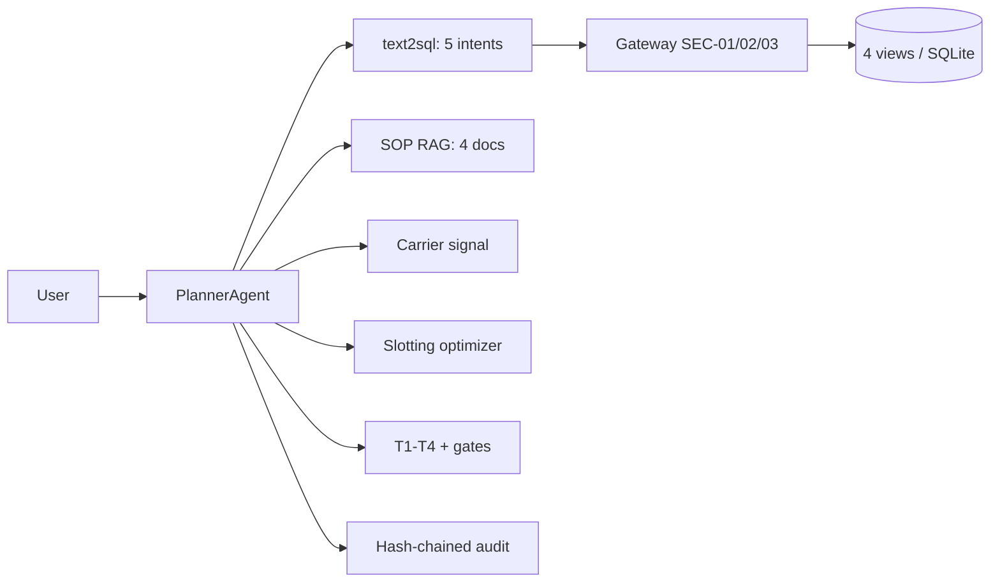

# Warehouse Ops Agents

> **Recruiter summary.** Ambient warehouses lose money to walking: fast-moving
> SKUs drift into the back of the building, pick waves get released over
> capacity, and late inbound starves the shift plan. This repo is an end-to-end
> operations agent for a dry-goods warehouse: it answers governed questions
> over warehouse telemetry, runs an ABC-velocity slotting optimizer that
> computes travel savings per move, plans pick waves against capacity, and
> gates every wave release and large reslot plan behind human confirmation.
> Proof: **78 tests green** (regression checks on synthetic data), a
> deterministic anchor (a 45-picks/day SKU stranded 180 m from the dock with a
> net **15,052.8 m/day** travel saving after swapping out the dead stock in its
> golden-zone slot), and a hash-chained audit log whose
> tamper detection is tested.

**Purpose.** A portfolio showcase of agentic AI applied to warehouse
operations — built for hiring managers and clients evaluating agentic
engineering depth, and for engineers adopting the patterns
(see `docs/implementation-guide.md`).

## Problem → approach → outcome

- **Problem.** Slotting goes stale (velocity drifts, nobody re-runs the
  optimizer), waves release over capacity because the plan "looked fine",
  and late inbound is discovered when the shift is already idle.
- **Approach.** A ReAct planner over governed telemetry: five NL intents map
  to fixed SELECT templates over four read-only views (SELECT-only gateway
  with cited rule IDs); a TF-IDF SOP retriever cites policy excerpts; a
  carrier signal degrades to an explicit gap; an ABC slotting optimizer and
  a wave planner run as audited tools; T1–T4 escalation tiers and
  confirmation gates guard the risky actions.
- **Outcome.** Cited answers ("which SKUs are mis-slotted?" → the exact SKUs,
  zones, and SOP sections), a ranked reslot plan with meters/day saved, and
  a wave plan that refuses to release over capacity without a human.

## Architecture



Full diagrams: [`knowledge/architecture.md`](knowledge/architecture.md);
domain notes: [`knowledge/domain-notes.md`](knowledge/domain-notes.md).

## How it works, step by step

1. `warehouse/telemetry.py` seeds a synthetic 30-day warehouse (SKUs with
   ABC velocity classes, zones with dock distances, slots, inbound
   shipments, waves, labor shifts) into SQLite.
2. `warehouse/views.py` exposes four read-only views through a SELECT-only
   gateway (rule IDs `SEC-SELECT-01`, `SEC-WRITE-02`, `SEC-VIEW-03`).
3. `warehouse/text2sql.py` maps five intents (slotting adherence, wave
   progress, inbound backlog, labor utilization, mis-slotted SKUs) to fixed
   SQL templates, with one simplified-query retry before escalation.
4. `warehouse/sop_rag.py` retrieves cited SOP excerpts, or says explicitly
   when nothing is found.
5. `warehouse/slotting.py` scores every slot against its velocity class and
   recommends moves ranked by meters/day saved.
6. `warehouse/waves.py` packs orders into waves by zone and priority,
   flagging over-capacity waves.
7. `warehouse/orchestrator.py` fans out across tools, assesses a T1–T4
   tier, mints confirmation-gate tokens for reslot plans over 8
   labor-hours and for every wave release, and audit-logs every step.

## Real code and real output

Slotting optimizer on the seeded data:

```python
from warehouse import telemetry, views, slotting
conn = telemetry.connect(); views.bootstrap(conn, seed=42)
recs = slotting.recommend_moves(conn)
```

```python
{'sku': 'SKU-FAST-01', 'sku_name': 'Widget Pro A', 'velocity_class': 'A',
 'avg_daily_picks': 45.0, 'slot_id': 'SLOT-001', 'from_zone': 'Z-BACK',
 'to_zone': 'Z-GOLD', 'move_type': 'swap', 'swap_with': 'SKU-DEAD-07',
 'saving_m_per_day': 15052.8, 'labor_hours': 1.0}
```

(The full run, re-checked by CI, is in the review section below.)

Planner answer to "Which SKUs are mis-slotted?":

```
[misplaced_skus] 2 row(s) from governed views.
Worst mis-slot: Widget Pro A (SKU-FAST-01), velocity A at 45.0 picks/day,
sitting in Back of building (180.0 m from dock).
Per the warehouse SOPs:
- sop-02-putaway-slotting.md §ABC velocity slotting: 1. Classify every SKU ...
Escalation tier: T2.
```

## How to run

Offline first (stdlib only, no dependencies):

```bash
python -m pytest tests/ -q        # 78 tests
python - <<'EOF'
from warehouse import telemetry, views, orchestrator
conn = telemetry.connect(); views.bootstrap(conn, seed=42)
p = orchestrator.PlannerAgent(conn, "docs/sops")
print(p.ask("Which SKUs are mis-slotted?")["answer"])
EOF
```

Optional demo UI (needs streamlit):

```bash
pip install streamlit
streamlit run demo/app.py
```

## How this differs from the cold-chain and retail repos

This repo shares the FDE spine (governed text-to-SQL, SOP RAG, escalation
tiers, hash-chained audit) with
[`Jagadish-coldchain-logistics-agents`](https://github.com/jagadishmazure-jpg/Jagadish-coldchain-logistics-agents)
and
[`Jagadish-retail-ops-agents`](https://github.com/jagadishmazure-jpg/Jagadish-retail-ops-agents),
but the domain is different and so is the engineering:

- **Ambient, not reefer or storefront.** No temperature telemetry, no
  compliance clock — the cost driver is picker travel and labor, modeled
  explicitly in meters per day.
- **Slotting optimizer (only here).** ABC-velocity analysis recommends
  concrete slot reassignments with a computed travel-saving estimate per
  move. Neither sibling repo has an optimizer that changes the operation.
- **Wave-planning engine (only here).** Orders are packed into waves by
  zone and priority against a capacity ceiling; over-capacity waves are
  flagged and every release is confirmation-gated.
- **Carrier ETA signal** instead of weather/demand: fake/live backends with
  explicit gap behavior.

**Boundary with the cold-chain repo.** Cold-chain works *between* sites:
reefer trucks in transit, temperature breaches, port diversions. This repo
works *inside one building*: where each SKU sits, how orders are batched into
pick waves, and whether a shift's labor fits the plan. A cold-chain shipment
ends where this repo's receiving SOP begins; neither repo reads the other's data.

## Guardrails and security controls

- SELECT-only gateway over four views; denials cite `SEC-SELECT-01`, `SEC-WRITE-02`, `SEC-VIEW-03`;
  a SQLite authorizer enforces the view allowlist (ADR 0001);
  string literals stripped before scanning (no false positives).
- Reslot plans above 8 labor-hours and **every** wave release need a human
  confirmation token.
- Feedback free text is PII-redacted (emails, SSN-shaped and 10+ digit numbers) before it
  enters the append-only audit chain; over-length corrections rejected.
- Tamper-evident audit: `verify_chain()` fails on any alteration (tested).
- Threat model: [`docs/threat-model.md`](docs/threat-model.md).

## Limitations and known failures

- Telemetry is **synthetic**; velocity classes are static, not re-derived
  from pick history. Production must recompute them (see
  `docs/implementation-guide.md`).
- The optimizer recommends forward moves for fast SKUs; it does not model
  slot-occupancy swaps (e.g. evicting slow SKU-DEAD-07 from the golden zone
  is flagged as mis-slotted but not auto-planned, because moving it back
  adds travel — freeing the slot is a human decision).
- Labor cost is a flat 0.5 h per move placeholder.
- The carrier live backend is a stubbed interface; tests exercise the fake.
- The Streamlit demo is explicitly a demo: no auth, in-memory gates.

## Module map

| Module | Role |
|---|---|
| `warehouse/telemetry.py` | Synthetic SQLite warehouse (seeded, deterministic) |
| `warehouse/views.py` | 4 read-only views + SELECT-only gateway |
| `warehouse/text2sql.py` | 5 NL intents → fixed SQL, retry, escalation |
| `warehouse/slotting.py` | ABC-velocity slotting optimizer (differentiator) |
| `warehouse/waves.py` | Wave-planning engine with capacity check (differentiator) |
| `warehouse/carrier.py` | Carrier ETA signal: fake + live (gap behavior) |
| `warehouse/sop_rag.py` | TF-IDF SOP retrieval with citations |
| `warehouse/orchestrator.py` | ReAct planner: fan-out, tiers, gates, audit |
| `warehouse/replenishment.py` | T1–T4 tiers + confirmation gates |
| `warehouse/audit.py` | Hash-chained audit log |
| `warehouse/feedback.py` | PII-redacted feedback capture into the audit chain |
| `warehouse/demo_helpers.py` | Stdlib demo logic (tested) |
| `demo/app.py` | Thin Streamlit UI (lazy import) |

## Standardization review (2026-10-18)

Reviewed against the portfolio standard after the build. Bugs found and fixed, each now pinned by a test:

1. **Slotting optimizer recommended moves that could not happen.** Every slot holds a SKU, so Z-GOLD had no free slot, yet the optimizer sent SKU-FAST-01 there without checking capacity, and the dead stock (SKU-DEAD-07) taking the golden slot was never addressed. It now uses a free slot when one exists, otherwise swaps the fast mover with the slowest over-slotted SKU in that rank and nets the slow SKU's extra travel out of the saving (15,120 m/day gross becomes 15,052.8 net, 1.0 labor-hour for two moves). With no room and no swap partner, nothing is recommended.
2. **Waves were numbered zone-first.** `plan_waves` sorted by (zone, priority), so a P3 wave in zone A came before a P1 wave in zone B. Waves are now ordered priority-first.
3. **Feedback redaction missed SSNs.** The digit-run pattern needs 10+ digits, so `123-45-6789` (9) stayed in the log. An SSN pattern was added.
4. **Gateway allowlist bypass.** `check()` only looked at names written right after `FROM`/`JOIN` and whitespace, so a comma join (`FROM v_x, base_table`), a double-quoted name (`JOIN "sqlite_master"`) or a comment in place of the space (`FROM/**/base_table`) read base tables and the schema. A SQLite authorizer now refuses every read that is not an allowlisted view or done on a view's behalf (`authz.py`, ADR 0001); `/* */` comments are stripped before scanning; the 100-row cap is enforced at fetch time.

Differentiator on the seeded data (regenerated and checked by CI on every push):

<!-- run: python scripts/show_differentiator.py -->
```text
swap: SKU-FAST-01 Z-BACK -> Z-GOLD swap_with=SKU-DEAD-07 net 15052.8 m/day, 1.0 labor-h
{'moves': 1, 'total_saving_m_per_day': 15052.8, 'total_labor_hours': 1.0, 'requires_gate': False}
PLAN-W001 P1 Z-GOLD orders=['O-2'] units=200 over_capacity=False
PLAN-W002 P1 Z-GOLD orders=['O-3'] units=90 over_capacity=False
PLAN-W003 P2 Z-BACK orders=['O-4'] units=300 over_capacity=True
PLAN-W004 P3 Z-MID orders=['O-1'] units=120 over_capacity=False
```
<!-- /run -->

Test count (also checked by CI):

<!-- run: python scripts/count_tests.py -->
```text
78 tests collected
```
<!-- /run -->

### Authorizer template sync (2026-10-18)

The SQLite authorizer was updated to the shared strict, view-aware version.
A base-table read is allowed only when SQLite reports it on behalf of one of
the allowed views (the authorizer's view-name argument). A read with no view
name is denied. `sqlite_master` is always denied, even if listed, and so is
`load_extension`. None of this repo's views hit the false denial, so the change is preventive here.
`tests/test_authorizer_sync.py` drives the authorizer directly, independent
of the text check. It covers comma joins and comment-obfuscated joins with a
base table, every view, and view self-joins.

Known residual: a read that uses no columns of a table behind a view is
allowed, because SQLite reports the unused side of a view self-join the same
way. So `SELECT count(*) FROM <that table>` or `EXISTS (SELECT 1 FROM ...)`
can still reveal a row count, but no column data. Any column reference is
denied.

## Built / Written-not-run / Planned

| Status | Item |
|---|---|
| Built | Telemetry, views+gateway, 5 intents, SOP RAG, slotting optimizer, wave planner, carrier fake/live, orchestrator, tiers+gates, audit, PII-redacted feedback, Streamlit demo, 78 tests |
| Built | CI on every push: ruff, tests, docs drift check, hashed brand check, gitleaks; CodeQL; Dependabot |
| Planned | Live carrier feed wiring, weekly optimizer batch job, persisted confirmation gates, feedback-to-golden-case mining |

## Related repos

- `Jagadish-coldchain-logistics-agents` — same FDE spine for reefer logistics (temperature compliance focus).
- `Jagadish-retail-ops-agents` — same FDE spine for retail stores (stockout/returns focus).
- `Jagadish-agent-feedback-loop` — the feedback flywheel this repo's `feedback.py` feeds.

## Docs

- [`docs/implementation-guide.md`](docs/implementation-guide.md) — adopting these patterns in a real WMS.
- [`docs/interview-points.md`](docs/interview-points.md) — talking points; every claim backed by a test.
- [`docs/threat-model.md`](docs/threat-model.md) — STRIDE-style review.
- [`knowledge/domain-notes.md`](knowledge/domain-notes.md), [`knowledge/architecture.md`](knowledge/architecture.md) — domain background and diagrams.

---

*All data in this repo is synthetic and fictional. This is an independent
portfolio project, unaffiliated with any employer, client, or vendor. Test
counts above come from real runs of the suite in this repo.*
