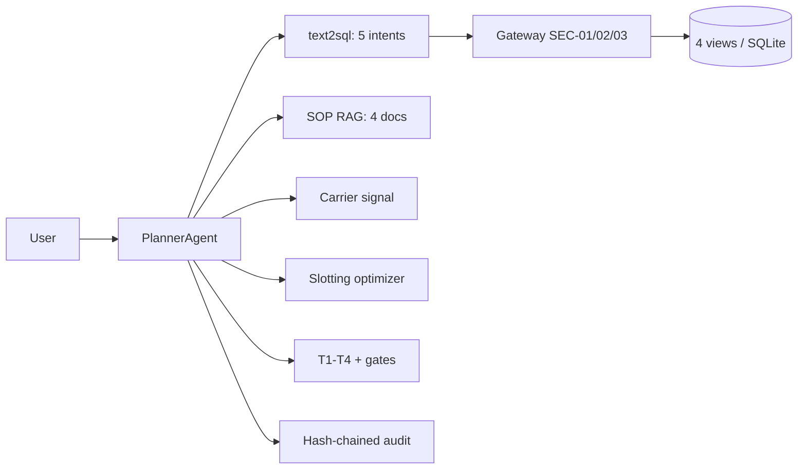

# Warehouse Ops Agents

> **Recruiter summary.** Ambient warehouses lose money to walking: fast-moving
> SKUs drift into the back of the building, pick waves get released over
> capacity, and late inbound starves the shift plan. This repo is an end-to-end
> operations agent for a dry-goods warehouse: it answers governed questions
> over warehouse telemetry, runs an ABC-velocity slotting optimizer that
> computes travel savings per move, plans pick waves against capacity, and
> gates every wave release and large reslot plan behind human confirmation.
> Proof: **52 tests green** (regression checks on synthetic data), a
> deterministic anchor (a 45-picks/day SKU stranded 180 m from the dock with a
> computed **15,120 m/day** travel saving), and a hash-chained audit log whose
> tamper detection is tested.

**Purpose.** A portfolio showcase of agentic AI applied to warehouse
operations — built for hiring managers and clients evaluating agentic
engineering depth, and for engineers adopting the patterns
(see `docs/implementation-guide.md`).

## Problem → approach → outcome

- **Problem.** Slotting goes stale (velocity drifts, nobody re-runs the
  optimizer), waves release over capacity because the plan "looked fine",
  and late inbound is discovered when the shift is already idle.
- **Approach.** A ReAct planner over governed telemetry: five NL intents map
  to fixed SELECT templates over four read-only views (SELECT-only gateway
  with cited rule IDs); a TF-IDF SOP retriever cites policy excerpts; a
  carrier signal degrades to an explicit gap; an ABC slotting optimizer and
  a wave planner run as audited tools; T1–T4 escalation tiers and
  confirmation gates guard the risky actions.
- **Outcome.** Cited answers ("which SKUs are mis-slotted?" → the exact SKUs,
  zones, and SOP sections), a ranked reslot plan with meters/day saved, and
  a wave plan that refuses to release over capacity without a human.

## Architecture



Full diagrams: [`knowledge/architecture.md`](knowledge/architecture.md);
domain notes: [`knowledge/domain-notes.md`](knowledge/domain-notes.md).

## How it works, step by step

1. `warehouse/telemetry.py` seeds a synthetic 30-day warehouse (SKUs with
   ABC velocity classes, zones with dock distances, slots, inbound
   shipments, waves, labor shifts) into SQLite.
2. `warehouse/views.py` exposes four read-only views through a SELECT-only
   gateway (rule IDs `SEC-SELECT-01`, `SEC-WRITE-02`, `SEC-VIEW-03`).
3. `warehouse/text2sql.py` maps five intents (slotting adherence, wave
   progress, inbound backlog, labor utilization, mis-slotted SKUs) to fixed
   SQL templates, with one simplified-query retry before escalation.
4. `warehouse/sop_rag.py` retrieves cited SOP excerpts, or says explicitly
   when nothing is found.
5. `warehouse/slotting.py` scores every slot against its velocity class and
   recommends moves ranked by meters/day saved.
6. `warehouse/waves.py` packs orders into waves by zone and priority,
   flagging over-capacity waves.
7. `warehouse/orchestrator.py` fans out across tools, assesses a T1–T4
   tier, mints confirmation-gate tokens for reslot plans over 8
   labor-hours and for every wave release, and audit-logs every step.

## Real code and real output

Slotting optimizer on the seeded data:

```python
from warehouse import telemetry, views, slotting
conn = telemetry.connect(); views.bootstrap(conn, seed=42)
recs = slotting.recommend_moves(conn)
```

```python
{'sku': 'SKU-FAST-01', 'sku_name': 'Widget Pro A', 'velocity_class': 'A',
 'avg_daily_picks': 45.0, 'from_zone': 'Z-BACK', 'to_zone': 'Z-GOLD',
 'saving_m_per_day': 15120.0, 'labor_hours': 0.5}
```

Planner answer to "Which SKUs are mis-slotted?":

```
[misplaced_skus] 2 row(s) from governed views.
Worst mis-slot: Widget Pro A (SKU-FAST-01), velocity A at 45.0 picks/day,
sitting in Back of building (180.0 m from dock).
Per the warehouse SOPs:
- sop-02-putaway-slotting.md §ABC velocity slotting: 1. Classify every SKU ...
Escalation tier: T2.
```

## How to run

Offline first (stdlib only, no dependencies):

```bash
python -m pytest tests/ -q        # 52 tests
python - <<'EOF'
from warehouse import telemetry, views, orchestrator
conn = telemetry.connect(); views.bootstrap(conn, seed=42)
p = orchestrator.PlannerAgent(conn, "docs/sops")
print(p.ask("Which SKUs are mis-slotted?")["answer"])
EOF
```

Optional demo UI (needs streamlit):

```bash
pip install streamlit
streamlit run demo/app.py
```

## How this differs from the cold-chain and retail repos

This repo shares the FDE spine (governed text-to-SQL, SOP RAG, escalation
tiers, hash-chained audit) with
[`Jagadish-coldchain-logistics-agents`](https://github.com/jagadishmazure-jpg/Jagadish-coldchain-logistics-agents)
and
[`Jagadish-retail-ops-agents`](https://github.com/jagadishmazure-jpg/Jagadish-retail-ops-agents),
but the domain is different and so is the engineering:

- **Ambient, not reefer or storefront.** No temperature telemetry, no
  compliance clock — the cost driver is picker travel and labor, modeled
  explicitly in meters per day.
- **Slotting optimizer (only here).** ABC-velocity analysis recommends
  concrete slot reassignments with a computed travel-saving estimate per
  move. Neither sibling repo has an optimizer that changes the operation.
- **Wave-planning engine (only here).** Orders are packed into waves by
  zone and priority against a capacity ceiling; over-capacity waves are
  flagged and every release is confirmation-gated.
- **Carrier ETA signal** instead of weather/demand: fake/live backends with
  explicit gap behavior.

## Guardrails and security controls

- SELECT-only gateway over four views; denials cite `SEC-SELECT-01/02/03`;
  string literals stripped before scanning (no false positives).
- Reslot plans above 8 labor-hours and **every** wave release need a human
  confirmation token.
- Feedback free text is PII-redacted (emails, 10+ digit numbers) before it
  enters the append-only audit chain; over-length corrections rejected.
- Tamper-evident audit: `verify_chain()` fails on any alteration (tested).
- Threat model: [`docs/threat-model.md`](docs/threat-model.md).

## Limitations and known failures

- Telemetry is **synthetic**; velocity classes are static, not re-derived
  from pick history. Production must recompute them (see
  `docs/implementation-guide.md`).
- The optimizer recommends forward moves for fast SKUs; it does not model
  slot-occupancy swaps (e.g. evicting slow SKU-DEAD-07 from the golden zone
  is flagged as mis-slotted but not auto-planned, because moving it back
  adds travel — freeing the slot is a human decision).
- Labor cost is a flat 0.5 h per move placeholder.
- The carrier live backend is a stubbed interface; tests exercise the fake.
- The Streamlit demo is explicitly a demo: no auth, in-memory gates.

## Module map

| Module | Role |
|---|---|
| `warehouse/telemetry.py` | Synthetic SQLite warehouse (seeded, deterministic) |
| `warehouse/views.py` | 4 read-only views + SELECT-only gateway |
| `warehouse/text2sql.py` | 5 NL intents → fixed SQL, retry, escalation |
| `warehouse/slotting.py` | ABC-velocity slotting optimizer (differentiator) |
| `warehouse/waves.py` | Wave-planning engine with capacity check (differentiator) |
| `warehouse/carrier.py` | Carrier ETA signal: fake + live (gap behavior) |
| `warehouse/sop_rag.py` | TF-IDF SOP retrieval with citations |
| `warehouse/orchestrator.py` | ReAct planner: fan-out, tiers, gates, audit |
| `warehouse/replenishment.py` | T1–T4 tiers + confirmation gates |
| `warehouse/audit.py` | Hash-chained audit log |
| `warehouse/feedback.py` | PII-redacted feedback capture into the audit chain |
| `warehouse/demo_helpers.py` | Stdlib demo logic (tested) |
| `demo/app.py` | Thin Streamlit UI (lazy import) |

## Built / Written-not-run / Planned

| Status | Item |
|---|---|
| Built | Telemetry, views+gateway, 5 intents, SOP RAG, slotting optimizer, wave planner, carrier fake/live, orchestrator, tiers+gates, audit, PII-redacted feedback, Streamlit demo, 52 tests |
| Written, not run | `.github/workflows/ci.yml` (present locally; GitHub Actions run happens after push) |
| Planned | Live carrier feed wiring, weekly optimizer batch job, persisted confirmation gates, feedback-to-golden-case mining |

## Related repos

- `Jagadish-coldchain-logistics-agents` — same FDE spine for reefer logistics (temperature compliance focus).
- `Jagadish-retail-ops-agents` — same FDE spine for retail stores (stockout/returns focus).
- `Jagadish-agent-feedback-loop` — the feedback flywheel this repo's `feedback.py` feeds.

## Docs

- [`docs/implementation-guide.md`](docs/implementation-guide.md) — adopting these patterns in a real WMS.
- [`docs/interview-points.md`](docs/interview-points.md) — talking points; every claim backed by a test.
- [`docs/threat-model.md`](docs/threat-model.md) — STRIDE-style review.
- [`knowledge/domain-notes.md`](knowledge/domain-notes.md), [`knowledge/architecture.md`](knowledge/architecture.md) — domain background and diagrams.

---

*All data in this repo is synthetic and fictional. This is an independent
portfolio project, unaffiliated with any employer, client, or vendor. Test
counts above come from real runs of the suite in this repo.*
