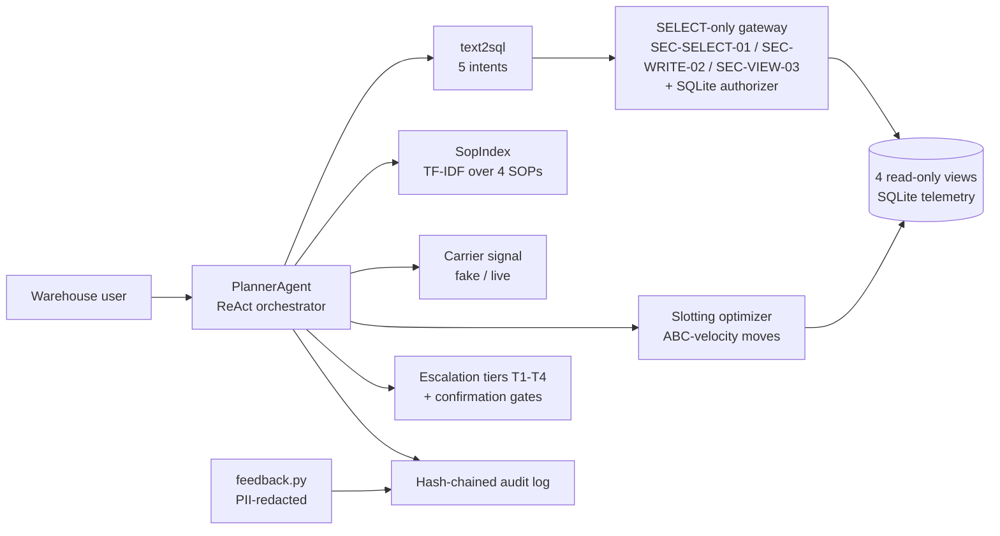
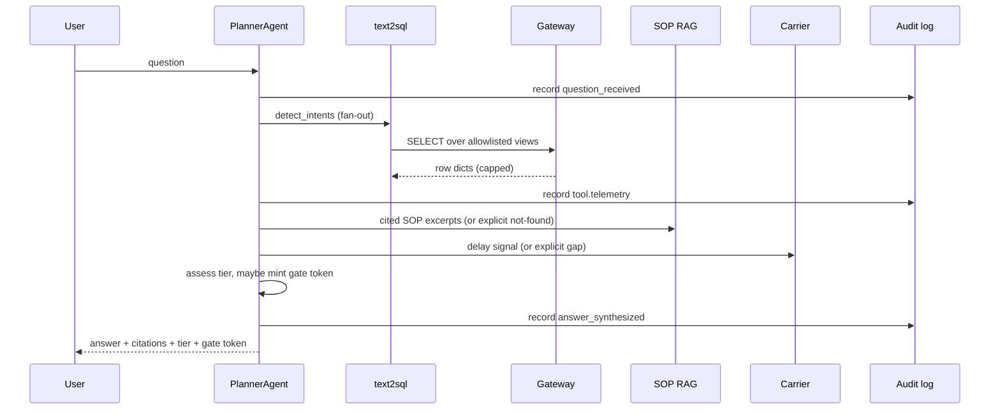
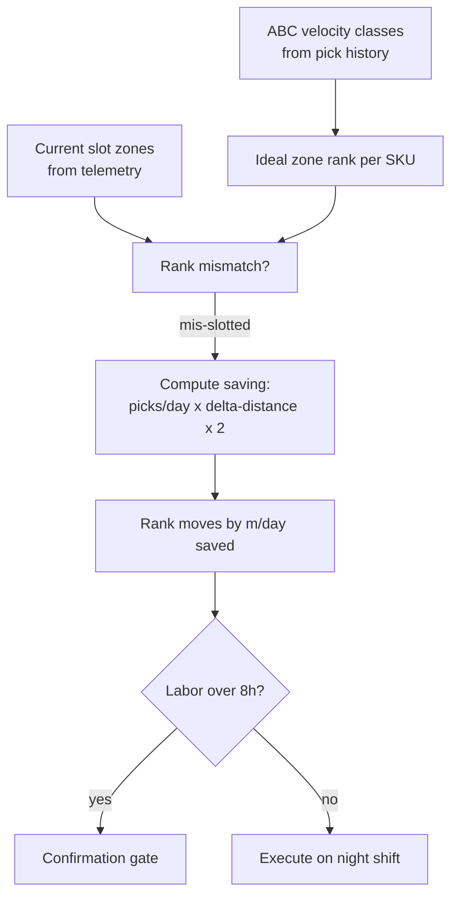

# Architecture

## System overview

## Data flow for one question

## Slotting optimizer loop

## Trust boundaries

- The planner never touches base tables: only the four views, through the
  gateway. A prompt-injection attempt that smuggles `DROP` or a second
  statement dies at SEC-SELECT-01 / SEC-WRITE-02 with a cited rule ID.
- The carrier feed is untrusted input: the fake backend is deterministic,
  the live backend degrades to an explicit gap, never a hallucinated ETA.
- Feedback free text is PII-redacted before it enters the append-only
  audit chain (emails and 10+ digit numbers become placeholders).
- Reslot plans above 8 labor-hours and every wave release need a human
  confirmation token before anything executes.
